# Weather Explorer

Weather Explorer is a full-stack weather intelligence and record-keeping web application built with Next.js 14, React 18, Tailwind CSS, Leaflet, and Prisma ORM with SQLite. The application serves as a consolidated dashboard providing real-time weather observations, a 24-hour hourly forecast timeline, a 5-day daily forecast, air pollution metrics, and an interactive weather map with server-proxied overlays. It also includes a persistent record management system supporting complete CRUD operations and multi-format data exports (JSON, CSV, XML, Markdown, and PDF).

---

## Table of Contents

- [Project Overview](#project-overview)
- [Problem Statement](#problem-statement)
- [Proposed Solution](#proposed-solution)
- [Key Features](#key-features)
- [How It Works (Step-by-Step)](#how-it-works-step-by-step)
- [System Architecture](#system-architecture)
- [Technology Stack](#technology-stack)
- [Project Structure](#project-structure)
- [Technical Implementation](#technical-implementation)
  - [Intelligent Geocoding Pipeline](#intelligent-geocoding-pipeline)
  - [Date Horizon & Range Validation](#date-horizon--range-validation)
  - [Secure Weather Tile Proxy](#secure-weather-tile-proxy)
  - [Range-Scoped Forecast Filtering](#range-scoped-forecast-filtering)
  - [Multi-Format Document Generation](#multi-format-document-generation)
- [Installation & Setup](#installation--setup)
- [Environment Configuration](#environment-configuration)
- [How to Run](#how-to-run)
- [Usage Instructions](#usage-instructions)
- [Example Input and Output](#example-input-and-output)
- [API Documentation](#api-documentation)
- [Database & Data Management](#database--data-management)
- [Testing & Verification](#testing--verification)
- [Actual Project Metrics](#actual-project-metrics)
- [Current Implementation Status](#current-implementation-status)
- [Limitations & Known Issues](#limitations--known-issues)
- [Future Improvements](#future-improvements)
- [Contributing](#contributing)
- [License](#license)
- [Acknowledgements](#acknowledgements)

---

## Project Overview

Weather Explorer was developed to fulfill the full-stack engineering requirements of the PM Accelerator AI Engineer Intern assessment. The project unifies two distinct functional milestones into a single, cohesive Next.js product:

1. **Frontend Assessment Milestone**: A responsive meteorological dashboard offering location search with debounced autocomplete, GPS geolocation lookup, current atmospheric conditions, 24-hour timeline, 5-day forecast, air quality indices, interactive mapping, dynamic unit conversion (°C/°F), and system-aware light/dark theming.
2. **Backend Assessment Milestone**: A relational record management system with persistent storage, full CRUD capabilities (Create, Read, Update, Delete), strict input validation against meteorological API horizons, and multi-format export utilities.

The architecture emphasizes security, reliability, and clean separation of concerns. Instead of exposing third-party API credentials to the browser, all geocoding, meteorological aggregation, and map tile streaming are routed through server-side Next.js route handlers.

---

## Problem Statement

Users monitoring weather patterns across domestic and international locations encounter several recurring technical and usability hurdles:

1. **Disjointed Weather Information**: Atmospheric data is often fragmented. Users must consult separate tools to check temperature, rain likelihood, air pollution levels, and radar imagery.
2. **Geocoding Failures on International Postal Codes**: Standard geocoding endpoints often assume numeric inputs are United States ZIP codes. An Indian 6-digit PIN code (such as `380001`) or non-US postal code queried naively will fail or return an incorrect US location.
3. **Fragile Weather Log Persistence**: When users attempt to save a forecast for an upcoming event or trip, typical applications only save the location name or a generic 5-day window. If the dates do not match the API's forecasting window, data becomes inaccurate or disconnected from the requested dates.
4. **Client-Side Credential Exposure in Interactive Maps**: Web map libraries (such as Leaflet) frequently load tile layers by appending API keys directly into client-side URL templates, exposing secret keys to anyone inspecting network requests.

---

## Proposed Solution

Weather Explorer addresses these challenges through a unified client and server architecture:

- **Single-Screen Meteorological Dashboard**: Combines a hero conditions card with four dedicated sub-views (**Today**, **5-Day**, **Air Quality**, and **Map**) so users can explore atmospheric metrics without leaving the page.
- **Robust Multi-Mode Geocoding**: Implements an intelligent geocoding resolver supporting city names, latitude/longitude coordinate pairs, formatted postal codes (`code, country`), and automated digit-length heuristics (5 digits defaulting to US, 6 digits defaulting to India).
- **Date-Range Constrained Weather Records**: A relational SQLite store managed by Prisma ORM that records locations alongside validated start and end dates. When saving a record, the server extracts and stores the forecast specific to that date range (`rangeForecast`) and calculates temperature bounds.
- **Zero-Credential Map Tile Proxy**: An internal server-side proxy route (`/api/tiles/[layer]/[z]/[x]/[y]`) fetches OpenWeatherMap tiles using the server's private key, forwards the binary PNG stream, and applies HTTP cache headers, keeping credentials completely hidden from client code.
- **Multi-Format Export Engine**: A streaming export handler that converts database records into JSON, CSV, XML, Markdown, or dynamically rendered PDF documents using PDFKit.

---

## Key Features

- **Real-Time Conditions**: Displays temperature, feels-like temperature, high/low bounds, humidity, barometric pressure, wind speed with 16-point compass direction, visibility in kilometers, cloud cover percentage, and local sunrise/sunset times adjusted to the location's UTC offset.
- **Search-as-You-Type Autocomplete**: Input field featuring 350ms debouncing, live location suggestions via OpenWeatherMap Geocoding API, and full keyboard navigation (Up/Down arrow selection, Enter, Escape).
- **Browser Geolocation**: One-click "Current location" button querying the browser HTML5 Geolocation API, reverse-geocoding coordinates to a canonical place name.
- **24-Hour Forecast Timeline**: Horizontal scrollable timeline displaying 3-hour forecast slots with weather condition icons, temperature, and precipitation chance.
- **5-Day Weather Forecast**: Daily forecast cards showing day-of-week abbreviations, weather icons, daily high and low temperatures, and maximum precipitation probabilities.
- **Air Quality & Chemical Breakdown**: Visual air pollution indicator mapped to the 1–5 EPA index (Good, Fair, Moderate, Poor, Very Poor) along with specific pollutant concentrations for $\text{PM}_{2.5}$, $\text{PM}_{10}$, $\text{O}_3$, $\text{NO}_2$, $\text{SO}_2$, and $\text{CO}$ in $\mu\text{g}/\text{m}^3$.
- **Interactive Leaflet Map with Overlays**: Client-side Leaflet map centered on resolved coordinates with toggleable meteorological layers: Precipitation, Clouds, Temperature, Wind, or base OpenStreetMap view.
- **Saved Locations CRUD**: Full management interface allowing users to create, view, update, and delete weather logs with associated date ranges.
- **Instant Record Recall**: Clicking the "View" action on any saved record instantly loads its stored weather and forecast data into the primary dashboard without issuing fresh external API requests.
- **Multi-Format Data Exports**: Export saved records into JSON, CSV, XML, Markdown, or PDF formats directly from the user interface.
- **Unit Conversion**: Instant toggle between Celsius (°C) and Fahrenheit (°F) across all current, hourly, and daily displays.
- **Theme Support**: Seamless Dark and Light theme switching powered by `next-themes` and Tailwind CSS custom CSS variables.
- **Defensive UI & Error Handling**: Displays skeleton loaders during data fetch states, inline field-level validation on location mismatches, and user-friendly toast notifications via Sonner.

---

## How It Works (Step-by-Step)

```
[ User Input / Geolocation ]
            │
            ▼
[ Geocoding Pipeline (/api/geocode/suggest or direct) ]
            │
            ├─► Matches City / ZIP / Coordinates
            │
            ▼
[ Parallel Server Aggregation (Promise.all) ]
    ├─► /api/weather/current     ──► OpenWeather Current API
    ├─► /api/weather/forecast    ──► OpenWeather 5-Day/3-Hour API
    └─► /api/weather/air-quality ──► OpenWeather Air Pollution API
            │
            ▼
[ Client Dashboard State Update ]
    ├─► Hero Card: Live metrics, local sunrise/sunset
    ├─► Tabs: Today (24h) | 5-Day | Air Quality | Map (Proxied Tiles)
            │
            ▼
[ Optional: Save to Database ]
    ├─► Validate Date Range (within 5-day API horizon)
    ├─► Filter Forecast to Range
    └─► Prisma saves to SQLite dev.db
            │
            ▼
[ Optional: Export Records ]
    └─► /api/export/[format] (JSON / CSV / XML / Markdown / PDF)
```

1. **Location Resolution**: The user types a city, postal code, or coordinate pair, or clicks "Current location". If typing, the debounced input queries `/api/geocode/suggest` to present matching places. When submitted, the query passes to the backend geocoder.
2. **Parallel Meteorological Ingestion**: The client issues three concurrent requests via `Promise.all` to `/api/weather/current`, `/api/weather/forecast`, and `/api/weather/air-quality`.
3. **Data Transformation & Rendering**: The backend normalizes the payloads into standardized units (metric base), calculates 16-point wind directions, computes timezone-adjusted sunrise/sunset times, extracts the next 24 hours (8 3-hour blocks), and groups forecasts by calendar day.
4. **Interactive Visualization**: The user can toggle between Celsius and Fahrenheit, switch between light and dark modes, and switch tabs to inspect hourly trends, 5-day outlooks, pollutant breakdown, or the interactive weather map.
5. **Persistent Record Keeping**: In the "Saved locations" section, the user selects a location and a date range. The server verifies that the dates fall within the valid 5-day horizon, extracts the matching forecast subset, and stores the record in SQLite via Prisma.
6. **Data Export**: Users can click any export badge (`JSON`, `CSV`, `XML`, `MARKDOWN`, or `PDF`) to trigger an immediate formatted file download.

---

## System Architecture

```mermaid
flowchart TD
    subgraph Client ["Client Browser (Next.js React Client)"]
        UI["Main Page (app/page.js)"]
        SB["SearchBar & Autocomplete"]
        CWC["CurrentWeatherCard"]
        TABS["Tabs Component"]
        TT["TodayTimeline (24h)"]
        FG["ForecastGrid (5-Day)"]
        AQC["AirQualityCard"]
        MV["MapView (Leaflet)"]
        RS["RecordsSection (CRUD Table)"]
        Theme["Theme & Unit Toggles"]
    end

    subgraph Server ["Next.js App Router Server Layer"]
        API_Geo["/api/geocode/suggest"]
        API_Curr["/api/weather/current"]
        API_Fore["/api/weather/forecast"]
        API_Air["/api/weather/air-quality"]
        API_Tiles["/api/tiles/[layer]/[z]/[x]/[y]"]
        API_Rec["/api/records & /api/records/[id]"]
        API_Exp["/api/export/[format]"]
        Lib_Weather["lib/weather.js (Validation & Fetching)"]
        Lib_Prisma["lib/prisma.js (Prisma Client Singleton)"]
    end

    subgraph Storage ["Local Storage"]
        DB[(SQLite: prisma/dev.db)]
    end

    subgraph External ["External Third-Party APIs"]
        OW_Geo["OpenWeather Geocoding API v1.0"]
        OW_Curr["OpenWeather Current Weather v2.5"]
        OW_Fore["OpenWeather 5-Day/3-Hour Forecast v2.5"]
        OW_Air["OpenWeather Air Pollution v2.5"]
        OW_Tiles["OpenWeather Map Tiles 1.0"]
        OSM["OpenStreetMap Tile Server"]
    end

    %% Client to Server Communication
    SB -->|q=query| API_Geo
    UI -->|location=query| API_Curr
    UI -->|location=query| API_Fore
    UI -->|location=query| API_Air
    MV -->|GET layer/z/x/y| API_Tiles
    MV -->|Base tiles| OSM
    RS -->|GET/POST/PUT/DELETE| API_Rec
    RS -->|Download| API_Exp

    %% Server Internal Routing
    API_Geo --> Lib_Weather
    API_Curr --> Lib_Weather
    API_Fore --> Lib_Weather
    API_Air --> Lib_Weather
    API_Rec --> Lib_Weather
    API_Rec --> Lib_Prisma
    API_Exp --> Lib_Prisma

    %% Server to Database
    Lib_Prisma --> DB

    %% Server to External APIs
    Lib_Weather -->|Geocoding| OW_Geo
    Lib_Weather -->|Current Data| OW_Curr
    Lib_Weather -->|Forecast Data| OW_Fore
    Lib_Weather -->|Pollution Data| OW_Air
    API_Tiles -->|Stream Tiles with Server Key| OW_Tiles
```



---

## Technology Stack

| Layer / Role | Technology | Version | Purpose |
|---|---|---|---|
| **Framework** | Next.js | `14.2.35` | Full-stack React framework with App Router, API routes, and SSR |
| **Language / Runtime** | JavaScript / Node.js | Tested on `v22.21.0` | Server runtime and application logic |
| **Frontend UI Library** | React / React DOM | `18.3.1` | Declarative component rendering and state management |
| **Styling & Design** | Tailwind CSS | `3.4.7` | Utility-first CSS framework with dynamic CSS custom properties |
| **CSS Processing** | PostCSS / Autoprefixer | `8.4.40` / `10.4.19` | CSS compilation and cross-browser vendor prefixing |
| **Mapping Engine** | Leaflet / React-Leaflet | `1.9.4` / `4.2.1` | Interactive web mapping and tile layer rendering |
| **Iconography** | Lucide React | `0.408.0` | Feather-derived UI iconography and weather indicators |
| **Toast Notifications** | Sonner | `1.5.0` | Accessible and customizable toast notifications |
| **Theme Management** | Next-Themes | `0.3.0` | Class-based dark and light theme provider |
| **PDF Generation** | PDFKit | `0.15.0` | Server-side binary PDF document rendering |
| **Text Encoding** | iconv-lite | `0.6.3` | Multi-format text and byte encoding |
| **Database ORM** | Prisma | `5.18.0` | Type-safe database client and schema migrations |
| **Database Engine** | SQLite | Built-in file engine | Embedded relational database (`prisma/dev.db`) |
| **Typography** | Inter (Google Fonts) | Managed via `next/font` | Optimized sans-serif UI typography |

---

## Project Structure

```
weather-nextjs/
├── app/
│   ├── api/
│   │   ├── export/
│   │   │   └── [format]/
│   │   │       └── route.js           # Multi-format data export endpoint (JSON/CSV/XML/MD/PDF)
│   │   ├── geocode/
│   │   │   └── suggest/
│   │   │       └── route.js           # Debounced location autocomplete endpoint (limit 5)
│   │   ├── records/
│   │   │   ├── route.js               # Saved records list (GET) and record creation (POST)
│   │   │   └── [id]/
│   │   │       └── route.js           # Single record lookup (GET), update (PUT), delete (DELETE)
│   │   ├── tiles/
│   │   │   └── [layer]/[z]/[x]/[y]/
│   │   │       └── route.js           # Server-side proxy streaming weather map tiles
│   │   └── weather/
│   │       ├── air-quality/
│   │       │   └── route.js           # Fetches EPA AQI and pollutant concentrations
│   │       ├── current/
│   │       │   └── route.js           # Fetches real-time atmospheric conditions
│   │       └── forecast/
│   │           └── route.js           # Fetches and structures 24h hourly and 5-day daily forecast
│   ├── globals.css                    # Tailwind directives, CSS root variables, and Leaflet overrides
│   ├── layout.js                      # Root layout, Inter font configuration, and metadata
│   ├── page.js                        # Main dashboard: state management, search, tabs, and records
│   └── providers.js                   # Client provider wrapper: NextThemes ThemeProvider and Sonner Toaster
├── components/
│   ├── AirQualityCard.jsx             # AQI badge and chemical breakdown grid
│   ├── CurrentWeatherCard.jsx         # Hero conditions card with 8 detailed atmospheric metrics
│   ├── Footer.jsx                     # Project and candidate attribution collapsible component
│   ├── ForecastGrid.jsx               # 5-day daily weather summary cards
│   ├── MapView.jsx                    # Client-side dynamic Leaflet map with layer selection buttons
│   ├── RecordsSection.jsx             # Saved records form, validation display, and CRUD table
│   ├── SearchBar.jsx                  # Input field with autocomplete dropdown and geolocation trigger
│   ├── Tabs.jsx                       # Navigation tab bar for Today, 5-Day, Air Quality, and Map
│   ├── ThemeToggle.jsx                # Dark / Light theme switch button
│   ├── TodayTimeline.jsx              # 24-hour horizontal scrolling forecast timeline
│   ├── UnitToggle.jsx                 # Celsius (°C) / Fahrenheit (°F) unit toggle
│   └── WeatherIcon.jsx                # Condition and day/night icon mapper for Lucide icons
├── lib/
│   ├── format.js                      # Client-side temperature unit converter and unit suffix helper
│   ├── prisma.js                      # Global PrismaClient singleton configuration
│   ├── serialize.js                   # Record deserializer parsing weatherData JSON strings
│   └── weather.js                     # OpenWeatherMap API client, geocoders, and validation rules
├── prisma/
│   ├── dev.db                         # SQLite local relational database file
│   └── schema.prisma                  # Prisma data model definition for WeatherRecord
├── .env                               # Environment variables (Database URL and API key)
├── .gitignore                         # Git exclusion rules for dependencies, env files, and build assets
├── jsconfig.json                      # Path alias configuration mapping @/* to ./*
├── next.config.mjs                    # Next.js configuration (strict mode and external server packages)
├── package.json                       # Project manifests, scripts, and dependency definitions
├── package-lock.json                  # Locked dependency tree
├── postcss.config.mjs                 # PostCSS configuration for Tailwind CSS
└── tailwind.config.js                 # Tailwind CSS theme extension and custom color tokens
```

---

## Technical Implementation

### Intelligent Geocoding Pipeline

The geocoding resolver implemented in [`lib/weather.js`](file:///e:/Projects/Assessments/weather-nextjs/lib/weather.js#L24-L74) executes a multi-stage fallback strategy to resolve diverse user inputs:

1. **Direct Coordinate Parsing**: Detects if the input contains a comma separating two numbers. If both numbers fall within valid geographical ranges ($-90 \le \text{latitude} \le 90$ and $-180 \le \text{longitude} \le 180$), it triggers reverse geocoding via OpenWeatherMap's Reverse Geocoding API to resolve the canonical location name.
2. **Explicit Postal Code Match**: Uses regular expressions to match queries formatted as `<code>, <CC>` (e.g., `380001, IN` or `78701, US`), directly querying the OpenWeatherMap ZIP Geocoding API.
3. **Digit Length Heuristic**: Prevents foreign postal codes from defaulting to US lookups. If the query consists purely of digits:
   - 5 digits: Evaluated as a US ZIP code (`zip=${code},US`).
   - 6 digits: Evaluated as an Indian PIN code (`zip=${code},IN`).
4. **Direct City Name Geocoding**: Queries OpenWeatherMap's direct geocoding endpoint (`/geo/1.0/direct?q=${query}&limit=1`).
5. **Defensive Error Handling**: If all resolution stages fail, throws a custom `WeatherApiError` with HTTP status `404`, guiding the user on valid input formats.

### Date Horizon & Range Validation

The OpenWeatherMap 5-day forecast API only projects data up to 5 days into the future and does not include historical records on the free tier. To ensure data consistency, [`lib/weather.js`](file:///e:/Projects/Assessments/weather-nextjs/lib/weather.js#L208-L237) enforces strict validation rules before saving a record:

- **Format & Validity**: Validates that both dates match the `YYYY-MM-DD` ISO format and represent real calendar dates.
- **Chronology**: Confirms that `startDate <= endDate`.
- **Maximum Duration**: Rejects ranges spanning more than 4 days between start and end (a maximum span of 5 calendar days inclusive).
- **Past Date Boundary**: Rejects ranges where `endDate` precedes yesterday (`endDate < yesterday`), preventing invalid historical lookups while allowing a 1-day grace window for international timezone discrepancies (e.g., UTC+5:30).
- **Future Horizon Boundary**: Rejects ranges where `startDate` extends beyond 6 days from the current date.

### Secure Weather Tile Proxy

To prevent leaking the secret `OPENWEATHER_API_KEY` to the client browser, weather map tiles are routed through a server-side proxy route handler in [`app/api/tiles/[layer]/[z]/[x]/[y]/route.js`](file:///e:/Projects/Assessments/weather-nextjs/app/api/tiles/[layer]/[z]/[x]/[y]/route.js#L1-L30):

- **Layer Whitelisting**: Restricts tile requests to permitted layers (`precipitation_new`, `clouds_new`, `temp_new`, `wind_new`, `pressure_new`) to prevent arbitrary upstream URL injection.
- **Server-Side Fetch**: The server attaches `OPENWEATHER_API_KEY` to the upstream OpenWeather tile URL (`https://tile.openweathermap.org/map/${layer}/${z}/${x}/${y}.png`).
- **Binary Streaming & Caching**: The response is returned as an `image/png` buffer with HTTP response headers:
  ```http
  Content-Type: image/png
  Cache-Control: public, max-age=600, immutable
  ```

### Range-Scoped Forecast Filtering

When a user saves a location with a date range, the application does not simply store the entire raw 5-day forecast. The function `filterForecastToRange(daily, startDate, endDate)` filters the 5-day daily forecast list to only include days where `startDate <= day.date <= endDate`.

In the UI, [`components/RecordsSection.jsx`](file:///e:/Projects/Assessments/weather-nextjs/components/RecordsSection.jsx#L94-L102) extracts `rangeForecast` to dynamically compute and display the minimum and maximum temperatures across that specific date range:

$$\text{Range Summary} = \min_{d \in \text{range}}(d.\text{tempMinC}) \text{ to } \max_{d \in \text{range}}(d.\text{tempMaxC})$$

### Multi-Format Document Generation

[`app/api/export/[format]/route.js`](file:///e:/Projects/Assessments/weather-nextjs/app/api/export/[format]/route.js#L1-L111) queries all records from SQLite and provides programmatic conversion into five standard formats:

1. **JSON**: Formatted using `JSON.stringify(records, null, 2)` with `Content-Type: application/json`.
2. **CSV**: Extracts standard columns (`id`, `resolvedName`, `startDate`, `endDate`, `createdAt`, `updatedAt`) with CSV double-quote escaping (`""`) and `Content-Type: text/csv`.
3. **XML**: Serializes records into a `<weatherRecords>` XML tree, escaping XML control characters (`&`, `<`, `>`) with `Content-Type: application/xml`.
4. **Markdown**: Builds a Markdown table containing record metadata with `Content-Type: text/markdown`.
5. **PDF**: Streams a formatted tabular report using `pdfkit`. The configuration in [`next.config.mjs`](file:///e:/Projects/Assessments/weather-nextjs/next.config.mjs#L5-L7) marks `pdfkit` and `fontkit` as `serverComponentsExternalPackages` to ensure clean Node.js runtime compilation.

---

## Installation & Setup

### Prerequisites

- **Node.js**: Version `18.17.0` or higher (tested on `v22.21.0`).
- **npm**: Version `9.0.0` or higher.
- **OpenWeatherMap API Key**: Free tier account from [OpenWeatherMap](https://openweathermap.org/api) (provides 60 calls/minute and 1,000,000 calls/month).

### Step-by-Step Installation

1. **Clone the repository**:
   ```bash
   git clone https://github.com/KrishPatel-AI/WeatherApp.git
   cd WeatherApp
   ```

2. **Install project dependencies**:
   ```bash
   npm install
   ```
   *(Note: The `package.json` includes a `postinstall` script that automatically triggers `prisma generate` to compile the Prisma client).*

3. **Configure environment variables**:
   Create a `.env` file in the project root:
   ```bash
   # On Windows PowerShell:
   New-Item -ItemType File -Name .env
   ```
   Populate the `.env` file with the required variables (see [Environment Configuration](#environment-configuration)).

4. **Initialize the SQLite database**:
   Run Prisma's schema push command to ensure the SQLite database file and tables are initialized:
   ```bash
   npx prisma db push
   ```

---

## Environment Configuration

The application requires two environment variables defined in a `.env` file at the root of the project:

| Variable Name | Required | Default / Example Value | Description |
|---|---|---|---|
| `DATABASE_URL` | Yes | `"file:./dev.db"` | Prisma connection string pointing to the local SQLite database file located in the `prisma/` folder |
| `OPENWEATHER_API_KEY` | Yes | `your_openweathermap_api_key_here` | Secret API key obtained from OpenWeatherMap used for server-side geocoding, weather queries, and tile proxying |

### Safe Configuration Example (`.env`)

```env
DATABASE_URL="file:./dev.db"
OPENWEATHER_API_KEY=your_openweathermap_api_key_here
```

> [!IMPORTANT]
> Keep your `OPENWEATHER_API_KEY` confidential. It must never be committed to source control or prefixed with `NEXT_PUBLIC_`.

---

## How to Run

### Development Mode

Start the local development server with hot-reloading:

```bash
npm run dev
```

The application will be accessible at:
```
http://localhost:3000
```

### Production Build & Execution

To test the optimized production build locally:

1. **Compile the production application**:
   ```bash
   npm run build
   ```

2. **Start the production server**:
   ```bash
   npm run start
   ```

---

## Usage Instructions

### 1. Searching for Weather

1. In the search box, enter a city name (e.g., `London`), an Indian PIN code (e.g., `380001`), a US ZIP code (e.g., `78701`), or an explicit code pair (e.g., `SW1A 1AA, GB`).
2. Alternatively, click the **Current location** button to allow browser geolocation to find your current coordinates.
3. As you type, an autocomplete dropdown displays up to 5 matching locations. Select a location using your mouse or keyboard arrow keys, or press `Enter` to search directly.

### 2. Navigating Meteorological Views

Once loaded, the hero card displays the current conditions. Use the navigation tabs below the hero card to inspect detailed metrics:

- **Today**: Displays a 24-hour horizontal scrolling timeline showing 3-hour temperature and precipitation intervals.
- **5-Day**: Shows daily forecast cards with minimum and maximum temperatures and precipitation likelihood.
- **Air Quality**: Displays the EPA AQI classification alongside specific chemical concentrations in $\mu\text{g}/\text{m}^3$.
- **Map**: Visualizes the location on an OpenStreetMap base map. Click any overlay pill (**Precipitation**, **Clouds**, **Temperature**, **Wind**, or **None**) to render server-proxied weather radar layers.

### 3. Toggling Units and Themes

- **Unit Switcher**: Click the **°C** or **°F** buttons in the header to switch between Celsius and Fahrenheit. All values recalculate instantly.
- **Theme Switcher**: Click the Sun/Moon icon in the header to toggle between light and dark modes.

### 4. Saving and Managing Weather Records (CRUD)

Scroll down to the **Saved locations** section:

- **Create Record**: Enter a location name, select a start date, select an end date (within 5 days from today), and click **Save**.
- **View Saved Record**: Click the **Eye icon** next to any record in the table. The application will instantly load the saved atmospheric data into the primary dashboard without issuing external API calls.
- **Edit Record**: Click the **Pencil icon** on a record row. The form will populate with the record's details. Make your adjustments and click **Update**.
- **Delete Record**: Click the **Trash icon** to remove a record from the database.
- **Export Data**: Click any format badge in the top right of the section (**JSON**, **CSV**, **XML**, **MARKDOWN**, or **PDF**) to download the entire dataset.

---

## Example Input and Output

### 1. Autocomplete Suggestion Request

**Request:**
```http
GET /api/geocode/suggest?q=Austin
```

**Response (JSON):**
```json
[
  {
    "label": "Austin, Texas, US",
    "lat": 30.2711286,
    "lon": -97.7436995
  },
  {
    "label": "Austin, Manitoba, CA",
    "lat": 49.953611,
    "lon": -98.937778
  }
]
```

### 2. Current Weather API Response

**Request:**
```http
GET /api/weather/current?location=Austin%2C%20TX
```

**Response (JSON):**
```json
{
  "location": {
    "name": "Austin, Texas, US",
    "lat": 30.2711,
    "lon": -97.7437
  },
  "current": {
    "tempC": 24.2,
    "feelsLikeC": 24.5,
    "tempMinC": 22.1,
    "tempMaxC": 26.8,
    "humidity": 65,
    "pressure": 1014,
    "visibilityMeters": 10000,
    "cloudsPercent": 20,
    "condition": "Clear",
    "description": "clear sky",
    "icon": "01d",
    "windSpeed": 3.6,
    "windDeg": 160,
    "sunrise": 1715082000,
    "sunset": 1715131200,
    "timezoneOffset": -18000
  }
}
```

### 3. Creating a Weather Record

**Request:**
```http
POST /api/records
Content-Type: application/json

{
  "location": "Austin, TX",
  "startDate": "2026-11-16",
  "endDate": "2026-11-18"
}
```

**Response (JSON, Status 201 Created):**
```json
{
  "id": 8,
  "locationQuery": "Austin, TX",
  "resolvedName": "Austin, Texas, US",
  "latitude": 30.2711,
  "longitude": -97.7437,
  "startDate": "2026-11-16",
  "endDate": "2026-11-18",
  "weatherData": {
    "current": { "tempC": 24.2, "humidity": 65, "condition": "Clear" },
    "forecast": { "hourly": [...], "daily": [...] },
    "airQuality": { "aqi": 2, "label": "Fair", "color": "lime", "components": { "pm2_5": 8.4, "pm10": 15.2 } },
    "rangeForecast": [
      {
        "date": "2026-11-16",
        "tempC": 24.2,
        "tempMinC": 18.0,
        "tempMaxC": 26.5,
        "condition": "Clear",
        "precipitationChance": 10
      }
    ]
  },
  "createdAt": "2026-11-15T20:45:00.000Z",
  "updatedAt": "2026-11-15T20:45:00.000Z"
}
```

### 4. CSV Export Output Sample

```csv
"id","resolvedName","startDate","endDate","createdAt","updatedAt"
"1","New York, New York, US","2026-07-09","2026-07-10","2026-07-09T18:20:11.000Z","2026-07-09T18:20:11.000Z"
"7","Gandhinagar, Gujarat, IN","2026-07-10","2026-07-13","2026-07-10T09:15:44.000Z","2026-07-10T09:15:44.000Z"
```

---

## API Documentation

All API endpoints are implemented as Next.js Route Handlers located under `app/api/`.

| Method | Endpoint | Query / Body Parameters | Success Status | Description |
|---|---|---|---|---|
| `GET` | `/api/weather/current` | `?location=<string>` (required) | `200 OK` | Geocodes query and returns current atmospheric conditions and resolved coordinates |
| `GET` | `/api/weather/forecast` | `?location=<string>` (required) | `200 OK` | Returns `{ hourly, daily }` forecast data (24h hourly intervals and 5-day summaries) |
| `GET` | `/api/weather/air-quality` | `?location=<string>` (required) | `200 OK` | Returns EPA air pollution index (1–5) and pollutant chemical concentrations |
| `GET` | `/api/geocode/suggest` | `?q=<string>` (minimum 2 chars) | `200 OK` | Returns up to 5 matching location suggestions for search autocomplete |
| `GET` | `/api/tiles/[layer]/[z]/[x]/[y]` | Dynamic route params (`layer`, `z`, `x`, `y`) | `200 OK` | Server proxy streaming OpenWeatherMap radar tile images with cache headers |
| `GET` | `/api/records` | None | `200 OK` | Returns array of all saved weather records sorted by creation date descending |
| `POST` | `/api/records` | JSON body: `{ location, startDate, endDate }` | `201 Created` | Validates dates, fetches weather, extracts range forecast, and stores record |
| `GET` | `/api/records/[id]` | Route param: `id` (integer) | `200 OK` | Fetches a single weather record by ID (returns `404` if not found) |
| `PUT` | `/api/records/[id]` | Route param: `id`<br>JSON body: `{ location, startDate, endDate }` | `200 OK` | Updates location or date range, re-fetches data, and updates record |
| `DELETE` | `/api/records/[id]` | Route param: `id` (integer) | `200 OK` | Deletes the weather record with matching ID |
| `GET` | `/api/export/[format]` | Route param: `format` (`json`, `csv`, `xml`, `markdown`, `pdf`) | `200 OK` | Generates and downloads full export file with appropriate attachment header |

---

## Database & Data Management

The application utilizes **SQLite** via **Prisma ORM**. The data model is defined in [`prisma/schema.prisma`](file:///e:/Projects/Assessments/weather-nextjs/prisma/schema.prisma):

```prisma
generator client {
  provider = "prisma-client-js"
}

datasource db {
  provider = "sqlite"
  url      = env("DATABASE_URL")
}

model WeatherRecord {
  id            Int      @id @default(autoincrement())
  locationQuery String   // Raw text entered by user (e.g. "Austin, TX")
  resolvedName  String   // Canonical geocoded location name (e.g. "Austin, Texas, US")
  latitude      Float    // Geocoded latitude coordinate
  longitude     Float    // Geocoded longitude coordinate
  startDate     String   // Start date string in YYYY-MM-DD format
  endDate       String   // End date string in YYYY-MM-DD format
  weatherData   String   // Serialized JSON containing current, forecast, airQuality, and rangeForecast
  createdAt     DateTime @default(now())
  updatedAt     DateTime @updatedAt
}
```

### Data Management Notes

- **Client Singleton**: Instantiated in [`lib/prisma.js`](file:///e:/Projects/Assessments/weather-nextjs/lib/prisma.js) attached to `globalThis.prisma` to prevent socket exhaustion during Next.js development hot-reloading.
- **Serialization**: Complex meteorological payloads (including current weather, hourly forecast, daily forecast, air pollution, and range-specific projections) are serialized into the `weatherData` text column and deserialized cleanly via `lib/serialize.js`.
- **Database Location**: Stored locally at `prisma/dev.db`. Ignored in `.gitignore` to prevent committing local development databases to version control.

---

## Testing & Verification

### Build Verification

The application's compilation, type safety, and route resolution have been verified through Next.js production builds (`npm run build`):

```
Route (app)                              Size     First Load JS
┌ ○ /                                    9.62 kB         108 kB
├ ○ /_not-found                          873 B          88.6 kB
├ ƒ /api/export/[format]                 0 B                0 B
├ ƒ /api/geocode/suggest                 0 B                0 B
├ ƒ /api/records                         0 B                0 B
├ ƒ /api/records/[id]                    0 B                0 B
├ ƒ /api/tiles/[layer]/[z]/[x]/[y]       0 B                0 B
├ ƒ /api/weather/air-quality             0 B                0 B
├ ƒ /api/weather/current                 0 B                0 B
└ ƒ /api/weather/forecast                0 B                0 B
+ First Load JS shared by all            87.7 kB
  ├ chunks/117-96d66e1ec495b2a7.js       31.7 kB
  ├ chunks/fd9d1056-866aaa86d30dac83.js  53.6 kB
  └ other shared chunks (total)          2.36 kB

○  (Static)   prerendered as static content
ƒ  (Dynamic)  server-rendered on demand
```

### Automated Tests Status

- **Automated Test Suites**: None configured in repository (no Jest, Vitest, Cypress, or Playwright configuration files or test runners present in `package.json`).
- **Runtime Validation**: Verified through manual execution of all CRUD endpoints, search autocomplete workflows, server tile proxying, and multi-format exports.

---

## Actual Project Metrics

All metrics below are calculated directly from verified project files:

- **Source Code Files**:
  - React Components (`components/*.jsx`): 12 files
  - Application Route Handlers (`app/api/**/route.js`): 8 route handlers
  - App Core Files (`layout.js`, `page.js`, `providers.js`, `globals.css`): 4 files
  - Utility & Service Modules (`lib/*.js`): 4 files
  - Database Schema (`prisma/schema.prisma`): 1 file
- **Dependencies** (from `package.json`):
  - Production Dependencies: 12 packages (`@prisma/client`, `iconv-lite`, `leaflet`, `lucide-react`, `next`, `next-themes`, `pdfkit`, `react`, `react-dom`, `react-leaflet`, `sonner`)
  - Development Dependencies: 4 packages (`autoprefixer`, `postcss`, `prisma`, `tailwindcss`)
- **First Load JS (Production Bundle)**:
  - Shared JS Bundle: `87.7 kB`
  - Dashboard Route (`/`): `108 kB` total (`9.62 kB` route-specific)
- **External API Integrations**: 5 distinct OpenWeatherMap APIs (Geocoding, Current Weather, 5-Day Forecast, Air Pollution, Weather Maps 1.0) and OpenStreetMap tile servers.

---

## Current Implementation Status

### Completed & Verified Functionality

- [x] Real-time current weather fetching with full atmospheric details.
- [x] 24-hour timeline in 3-hour intervals with precipitation probability.
- [x] 5-day daily forecast with minimum and maximum temperatures.
- [x] Air quality monitoring with EPA 1–5 AQI mapping and chemical breakdown ($\text{PM}_{2.5}$, $\text{PM}_{10}$, $\text{O}_3$, $\text{NO}_2$, $\text{SO}_2$, $\text{CO}$).
- [x] Interactive Leaflet map with dynamically selected, server-proxied weather overlays.
- [x] Search input with 350ms debounced suggestions and keyboard navigation.
- [x] Browser geolocation lookup with reverse geocoding.
- [x] International postal code support (including Indian 6-digit PIN codes).
- [x] Complete database CRUD operations for saved weather records (`GET`, `POST`, `PUT`, `DELETE`).
- [x] Strict date range validation rejecting invalid ranges and dates outside the 5-day forecast horizon.
- [x] Range-filtered forecast extraction and temperature bounds calculation.
- [x] Instant record recall ("View" button restores dashboard state without API calls).
- [x] Multi-format export system supporting JSON, CSV, XML, Markdown, and PDF.
- [x] Dynamic temperature unit switching (°C and °F).
- [x] Light and Dark theme switching with persistent class toggle.
- [x] Skeleton loading states and field-level validation feedback.

### Missing or Unimplemented Elements

- [ ] Automated unit or integration test suite (no test framework configured).
- [ ] Sample environment configuration file (`.env.example` is not present in the repository).
- [ ] Database migration tracking directory (schema managed via `prisma db push` rather than tracked `prisma/migrations`).

---

## Limitations & Known Issues

1. **SQLite Concurrency & Serverless Hosting**: The application uses a local SQLite database (`dev.db`). While well-suited for local development and single-instance VPS deployments, SQLite is not natively compatible with ephemeral serverless platforms (such as Vercel) where the local filesystem is read-only or reset across instances.
2. **OpenWeatherMap Free Tier Horizons**:
   - Forecast data is limited to a 5-day / 3-hour resolution window.
   - The free plan does not support historical weather lookups; consequently, records cannot be created for past dates.
   - API rate limit is capped at 60 calls per minute and 1,000,000 calls per month.
3. **Leaflet Client-Side Requirement**: Leaflet relies on browser window APIs (`window`, `navigator`) and cannot be executed during server-side rendering. The `MapView` component must always be imported using dynamic imports with `{ ssr: false }`.
4. **Missing `.env.example`**: The repository does not include a committed `.env.example` template; configuration must be created manually as documented in [Environment Configuration](#environment-configuration).

---

## Future Improvements

- **Database Provider Migration**: Introduce support for PostgreSQL or MySQL via Prisma connection strings to enable deployment on serverless platforms (e.g., Supabase, Neon, or PlanetScale).
- **Automated Test Suite**: Implement unit tests for geocoding and date validation using Vitest or Jest, alongside end-to-end user journey tests using Playwright.
- **Historical Data Support**: Integrate OpenWeatherMap One Call API 3.0 or alternative historical weather archives to permit logging past date ranges.
- **Severe Weather Alerts**: Integrate weather alert banners for active meteorological warnings (e.g., storms, heatwaves, or flood advisories).
- **Response Caching**: Implement Redis or in-memory caching for repetitive geocoding and weather queries to minimize upstream API credit consumption.

---

## Contributing

1. **Fork the Repository**: Create a personal fork on GitHub.
2. **Create a Feature Branch**:
   ```bash
   git checkout -b feature/your-feature-name
   ```
3. **Adhere to Code Standards**: Ensure clean Next.js App Router patterns, Tailwind CSS class consistency, and avoid placing secret API keys in client-accessible code.
4. **Verify Build**:
   ```bash
   npm run build
   ```
5. **Submit a Pull Request**: Provide a detailed description of changes and test steps.

---

## License

This project is currently marked as `private` in `package.json`. No open-source license file (`LICENSE`) is present in the repository root. All rights are reserved by the author.

---

## Acknowledgements

- **PM Accelerator**: For defining the comprehensive full-stack technical assessment specifications.
- **Author**: Krish Patel — AI Engineer Intern Candidate (Cohort #10).
- **OpenWeatherMap**: For providing comprehensive meteorological APIs, geocoding, and map tiles.
- **OpenStreetMap**: For open-source base map tiles.
- **Leaflet & React-Leaflet**: For open-source client-side interactive mapping.
- **Prisma**: For type-safe database access and schema tooling.
